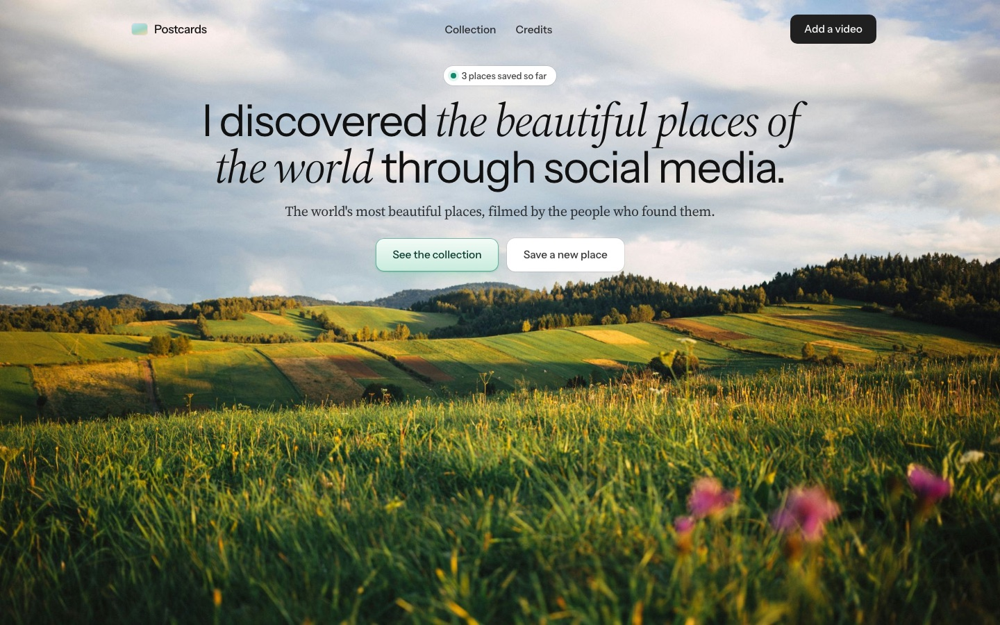
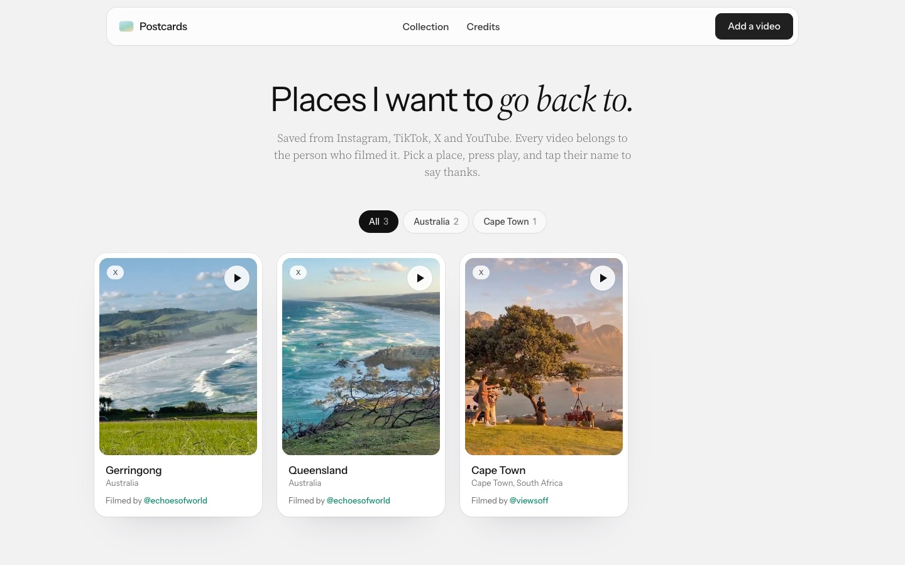

<p align="center">
  
</p>

<h1 align="center">Postcards</h1>

<p align="center">
  <em>The world's most beautiful places, filmed by the people who found them.</em>
</p>

<p align="center">
  <a href="https://postcard-beta-one.vercel.app"><strong>Live site</strong></a> ·
  <a href="#how-to-add-a-video">Add a video</a> ·
  <a href="#run-it-on-your-computer">Run it</a> ·
  <a href="#credits">Credits</a>
</p>

---

I discovered the beautiful places of the world through social media.

Postcards is my own collection of the nature videos I find online. A lot of them are from Cape Town. Each video plays right on the page, and each one names the person who filmed it, with a link back to their post.

<p align="center">
  
</p>

## Features

- **Plays the real video.** It works with links from Instagram, TikTok, X, YouTube and Vimeo, or a direct `.mp4` file.
- **Credit on every card.** The creator's @handle links to their profile. "Watch the original" opens their post.
- **Filter by place.** Buttons at the top group the videos by city or country.
- **A note to future me.** Each place can have a short note, like "Go at golden hour."
- **Easy to take down.** One click removes a video if the creator asks.
- **No build step.** It is plain HTML, CSS and JavaScript.

## How to add a video

1. Click **Add a video**.
2. Paste the video link.
3. Type the place, the city or country, and the creator's @handle.
4. Click **Save postcard**.

New videos are saved in your browser only. To put them on the live site for everyone:

1. Click **Export collection** at the bottom of the page.
2. Replace `videos.json` with the file you get.
3. Push to `main`. Vercel puts it live by itself.

## Run it on your computer

```bash
git clone https://github.com/rmagdaleena2508-01/PostCard.git
cd PostCard
python3 -m http.server 8900
```

Then open http://localhost:8900.

## Project files

```
index.html     the page: hero, collection, credits, player and add form
styles.css     all the styles
app.js         reads links, shows the cards, plays videos, saves new ones
videos.json    the shared list of saved videos
images/        the meadow photo for the hero
docs/          screenshots for this README
```

## Built with

- HTML, CSS and plain JavaScript
- [Instrument Sans](https://fonts.google.com/specimen/Instrument+Sans) and [Source Serif 4](https://fonts.google.com/specimen/Source+Serif+4)
- Hosted on [Vercel](https://vercel.com)

## Credits

Every video belongs to the person who filmed it. Videos play from where they were posted. Nothing is downloaded or uploaded again. If a creator asks, their video comes down.
